# 校园闲置物品租售系统

> 🎓 **计算机毕业设计 · 校园闲置物品租售系统**
>
> 本仓库只放**项目介绍 + 运行截图**（截图是站点带水印的原图，存在仓库 `images/` 里）。
>
> 👉 **完整可运行源码 / 数据库脚本 / 部署文档：[点我获取](https://geekcode.top/archives/%E6%A0%A1%E5%9B%AD%E9%97%B2%E7%BD%AE%E7%89%A9%E5%93%81%E7%A7%9F%E5%94%AE%E7%B3%BB%E7%BB%9F?utm_source=github)**
>
> 💬 咨询微信：**ir9372**　|　🌐 更多项目：[极客代码 geekcode.top](https://geekcode.top/?utm_source=github)
>
> 📌 项目详情页：<https://geekcode.top/archives/%E6%A0%A1%E5%9B%AD%E9%97%B2%E7%BD%AE%E7%89%A9%E5%93%81%E7%A7%9F%E5%94%AE%E7%B3%BB%E7%BB%9F?utm_source=github>

<table><td width="230" align="center"> <b>扫码加微信 ir9372</b></td><td valign="middle">📦 源码 = 项目介绍 + 全部运行截图 + 数据库 + 部署文档 👉 点上方任意截图，直接跳到 <b>极客代码 geekcode.top</b> 详情页</td></table>

---

<h1>校园闲置物品租售系统</h1>
<h2>项目概述</h2>

校园闲置物品租售系统旨在解决高校学生群体中闲置物品流转效率低、资源浪费严重的问题。本项目基于 Vue 与 Spring Boot 前后端分离架构开发，提供 Web 端前台用户交互界面与后台管理界面。核心功能涵盖商品信息的发布与管理、闲置物品的购买与租借交易流程、社区论坛交流以及校园资讯展示。系统适用于在校大学生及教职工进行二手物品交换、租赁共享及信息获取。技术层面采用 MyBatis-Plus 作为持久层框架以简化数据库操作，集成 Apache Shiro 实现细粒度的权限控制与安全认证，确保数据访问的安全性与系统的稳定性。

<h2>技术架构</h2>

本系统采用经典的前后端分离架构设计，前端使用 Vue.js 框架构建单页面应用（SPA），通过 HTTP 请求与后端进行数据交互；后端基于 Spring Boot 框架搭建 RESTful API 服务，实现了业务逻辑的高效处理与接口的标准化输出。

<strong>核心技术选型理由：</strong>

<ol>
<li><strong>Spring Boot</strong>: 提供快速构建能力，内置 Tomcat 容器，简化配置，适合中小型项目的快速迭代与维护。</li>
<li><strong>MyBatis-Plus</strong>: 在 MyBatis 基础上增强，提供了通用的 CRUD 接口和条件构造器，显著减少样板代码，提升开发效率。</li>
<li><strong>Apache Shiro</strong>: 轻量级安全框架，负责身份认证（Authentication）、授权（Authorization）及会话管理，保障用户隐私与系统安全。</li>
<li><strong>MySQL</strong>: 关系型数据库，用于存储用户信息、商品详情、订单记录及论坛帖子等结构化数据。</li>
</ol>

<strong>数据库设计要点：</strong>
数据库主要包含用户表、卖家表、商品信息表、商品分类表、商品购买记录表、商品租借记录表、评论表、收藏表、论坛帖子表、资讯表及系统配置表。各表之间通过外键关联，确保数据的一致性与完整性。例如，<code>shangpinxinxi</code>（商品信息）表关联 <code>maijia</code>（卖家）表和 <code>shangpinzhonglei</code>（商品种类）表，<code>storeup</code>（收藏）表关联用户与具体商品。

<a href="https://geekcode.top/archives/%E6%A0%A1%E5%9B%AD%E9%97%B2%E7%BD%AE%E7%89%A9%E5%93%81%E7%A7%9F%E5%94%AE%E7%B3%BB%E7%BB%9F?utm_source=github" title="查看完整源码">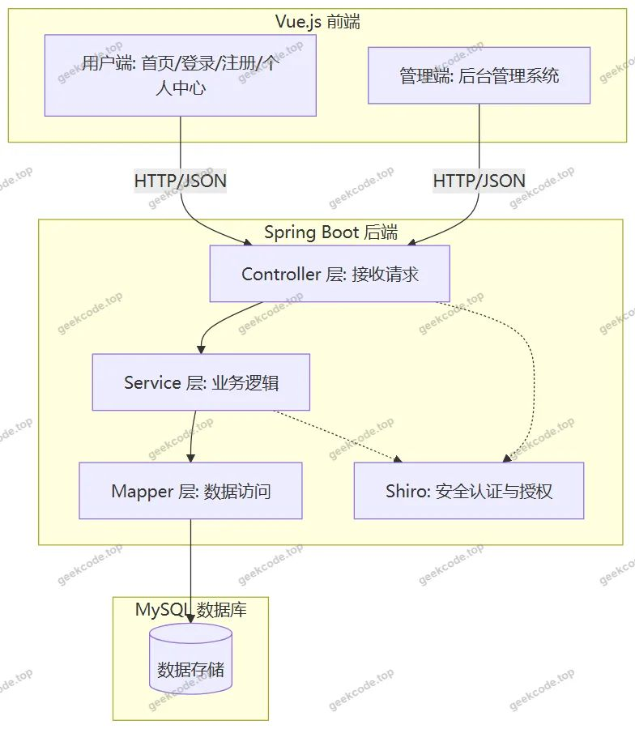</a>

<h2>功能模块</h2>

根据源码中的 Controller 列表及路由配置，系统功能模块划分为前台用户端与后台管理端两大部分。

<h3>前台用户端</h3>

前台面向普通注册用户（包括学生和潜在卖家），主要提供浏览、搜索、交易互动及个人信息管理功能。

<ol>
<li><strong>用户认证模块</strong></li>
</ol>
<ul>
<li><strong>注册与登录</strong>：支持新用户注册账号，老用户通过用户名密码登录系统。</li>
<li><strong>个人中心</strong>：查看和管理个人基本信息，维护账户状态。</li>
</ul>
<ol start="2">
<li><strong>商品展示与检索模块</strong></li>
</ol>
<ul>
<li><strong>商品信息浏览</strong>：展示所有上架的闲置物品，支持按类别筛选。</li>
<li><strong>商品详情</strong>：查看单个商品的详细描述、价格、卖家信息及图片。</li>
<li><strong>闲置鱼塘</strong>：类似社区板块，展示用户发布的闲置动态或求购/出售意向。</li>
</ul>
<ol start="3">
<li><strong>交易互动模块</strong></li>
</ol>
<ul>
<li><strong>商品购买</strong>：用户对感兴趣的商品发起购买请求。</li>
<li><strong>商品租借</strong>：针对可租赁商品，用户提交租借申请。</li>
<li><strong>商品评论</strong>：用户在商品详情页发表评价，与其他用户交流使用体验。</li>
<li><strong>我的收藏</strong>：将心仪商品加入收藏夹，便于后续快速访问。</li>
</ul>
<ol start="4">
<li><strong>资讯与论坛模块</strong></li>
</ol>
<ul>
<li><strong>校园资讯</strong>：浏览学校发布的新闻公告或生活指南。</li>
<li><strong>论坛交流</strong>：参与话题讨论，发布帖子，回复他人评论。</li>
</ul>
<h3>后台管理端</h3>

后台面向系统管理员，提供全量的数据管理与系统配置功能。

<ol>
<li><strong>基础数据管理</strong></li>
</ol>
<ul>
<li><strong>用户管理 (<code>/yonghu</code>)</strong>：查看、编辑、删除注册用户信息，重置密码等。</li>
<li><strong>卖家管理 (<code>/maijia</code>)</strong>：专门管理入驻卖家的资质与信息。</li>
<li><strong>商品种类管理 (<code>/shangpinzhonglei</code>)</strong>：维护商品分类字典，如电子产品、书籍、生活用品等。</li>
</ul>
<ol start="2">
<li><strong>业务数据管理</strong></li>
</ol>
<ul>
<li><strong>商品信息审核 (<code>/shangpinxinxi</code>)</strong>：查看所有商品列表，对违规或不实信息进行下架或删除处理。</li>
<li><strong>购买记录管理 (<code>/shangpingoumai</code>)</strong>：监控所有商品的购买订单状态，处理异常订单。</li>
<li><strong>租借记录管理 (<code>/shangpinzujie</code>)</strong>：监控所有商品的租借订单，跟踪归还状态。</li>
<li><strong>评论管理 (<code>/discussshangpinxinxi</code>)</strong>：审核用户评论，删除不良言论。</li>
</ul>
<ol start="3">
<li><strong>内容与系统管理</strong></li>
</ol>
<ul>
<li><strong>论坛管理 (<code>/forum</code>)</strong>：管理社区帖子，置顶、精华或删除违规内容。</li>
<li><strong>资讯管理 (<code>/news</code>)</strong>：发布、编辑、删除校园资讯文章。</li>
<li><strong>收藏管理 (<code>/storeup</code>)</strong>：查看用户的收藏数据统计（通常用于分析热门商品）。</li>
<li><strong>系统配置 (<code>/config</code>)</strong>：修改轮播图、网站名称、Logo 等全局参数。</li>
</ul>
<h2>用户角色与权限</h2>

系统基于 Apache Shiro 实现权限控制，主要存在两种角色：普通用户（前台）和管理员（后台）。

<table>
<thead>
<tr>
<th align="left">角色</th>
<th align="left">权限描述</th>
<th align="left">可访问的具体功能模块</th>
</tr>
</thead>
<tbody><tr>
<td align="left"><strong>普通用户</strong></td>
<td align="left">拥有浏览公共信息、参与交易互动及管理个人数据的权限。需登录后方可执行写操作（如发布、评论、下单）。</td>
<td align="left">1. <strong>公共模块</strong>：商品信息列表/详情、闲置鱼塘、校园资讯、论坛浏览。2. <strong>个人中心</strong>：个人信息修改、我的发布、我的收藏。3. <strong>交易模块</strong>：提交商品购买申请、提交商品租借申请、发表评论。4. <strong>社区模块</strong>：发布论坛帖子、回复评论。</td>
</tr>
<tr>
<td align="left"><strong>管理员</strong></td>
<td align="left">拥有系统最高权限，可对全站数据进行增删改查及配置管理。仅可通过后台入口访问。</td>
<td align="left">1. <strong>用户体系</strong>：用户管理、卖家管理。2. <strong>商品体系</strong>：商品信息审核、商品种类管理、商品购买记录查询、商品租借记录查询。3. <strong>互动体系</strong>：商品信息评论管理、论坛帖子管理、收藏记录查看。4. <strong>内容体系</strong>：校园资讯管理。5. <strong>系统设置</strong>：配置文件管理。</td>
</tr>
</tbody></table>

<em>注：普通用户若兼具“卖家”身份，其发布的商品数据将在后台由管理员统一审核；系统中未明确区分独立的“教师”或“学生”子角色，统一归类为“用户”，但后台设有专门的“卖家”管理模块，暗示部分用户可能经过认证成为专职或兼职卖家。</em>

<h2>项目特色与创新点</h2>
<ol>
<li>
<strong>“买租结合”的双模式交易机制</strong>
   传统二手平台多仅支持买卖，本系统创新性地引入了“商品租借”模块（<code>ShangpinzujieController</code>）。对于高价值或使用频率低的物品（如相机、乐器、教材），租借模式降低了学生的获取成本，提高了资源利用率，更贴合校园场景的实际需求。

</li>
<li>
<strong>垂直化的社区与资讯融合</strong>
   系统不仅是一个交易平台，还集成了“闲置鱼塘”和“校园资讯”模块。通过 <code>ForumController</code> 和 <code>NewsController</code>，构建了围绕校园生活的社交圈和信息流。这种“交易+社交+资讯”的一体化设计，增强了用户粘性，形成了闭环的校园生活服务生态。

</li>
<li>
<strong>精细化的后台数据治理</strong>
   后台管理覆盖了从基础分类（<code>Shangpinzhonglei</code>）到业务流程（<code>Shangpingoumai</code>, <code>Shangpinzujie</code>）再到互动反馈（<code>Discussshangpinxinxi</code>）的全链路数据。特别是将“卖家”与“普通用户”在后台管理中进行了逻辑分离（<code>MajiaController</code> vs <code>YonghuController</code>），便于对活跃交易者进行重点监管和服务优化。

</li>
<li>
<strong>基于 Shiro 的安全防护体系</strong>
   相较于简单的拦截器校验，引入 Apache Shiro 提供了更标准化的认证与授权机制。能够有效防止越权访问（如普通用户尝试调用管理员接口），并对敏感操作（如修改个人信息、删除评论）进行会话级别的保护，提升了系统的安全性基线。

</li>
</ol>
<h2>部署环境</h2>

为确保系统正常运行，需准备以下软硬件环境：

<strong>1. 硬件环境建议</strong>

<ul>
<li>CPU: 双核及以上</li>
<li>内存: 4GB 及以上</li>
<li>硬盘: 预留至少 10GB 存储空间</li>
</ul>

<strong>2. 软件环境要求</strong>

<ul>
<li><strong>操作系统</strong>: Windows 10/11, Linux (CentOS 7+, Ubuntu 18.04+) 或 macOS</li>
<li><strong>Java 运行环境</strong>: JDK 1.8 或更高版本（推荐 JDK 8，兼容性好）</li>
<li><strong>数据库</strong>: MySQL 5.7 或 MySQL 8.0</li>
<li><strong>Web 服务器</strong>: 内置 Tomcat（Spring Boot 自带，无需单独安装外部 Tomcat）</li>
<li><strong>前端运行环境</strong>: Node.js (用于编译 Vue 项目，推荐 LTS 版本)，包管理器 npm 或 yarn</li>
<li><strong>开发工具</strong>: IntelliJ IDEA 或 Eclipse (后端), VS Code (前端)</li>
</ul>

<strong>3. 依赖组件版本参考</strong>

<ul>
<li>Spring Boot: 2.x 系列</li>
<li>MyBatis-Plus: 3.x 系列</li>
<li>Shiro: 1.4.x - 1.6.x 系列</li>
<li>Vue.js: 2.x 或 3.x (视具体前端脚手架而定)</li>
</ul>
<h2>五、技术特性</h2>
<ul>
<li>前后端集成部署，前端资源打包至后端 static 目录</li>
<li>使用 MyBatis-Plus 简化数据访问层开发</li>
<li>集成 Shiro 权限框架实现角色权限控制</li>
</ul>
<h2>六、功能模块截图</h2>
<h3>前台用户端</h3>
<h4>前台首页</h4>

<h4>前台登录页</h4>

<h4>前台注册页</h4>

<h4>前台-闲置鱼塘列表</h4>

<a href="https://geekcode.top/archives/%E6%A0%A1%E5%9B%AD%E9%97%B2%E7%BD%AE%E7%89%A9%E5%93%81%E7%A7%9F%E5%94%AE%E7%B3%BB%E7%BB%9F?utm_source=github" title="查看完整源码">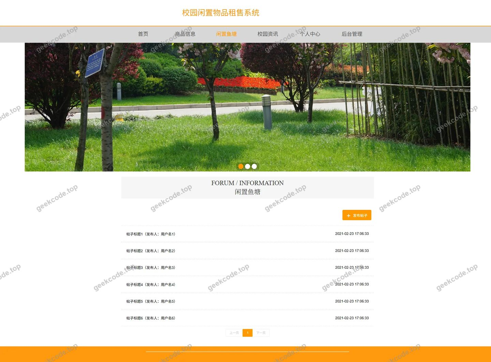</a>

<h4>前台-校园资讯列表</h4>

<a href="https://geekcode.top/archives/%E6%A0%A1%E5%9B%AD%E9%97%B2%E7%BD%AE%E7%89%A9%E5%93%81%E7%A7%9F%E5%94%AE%E7%B3%BB%E7%BB%9F?utm_source=github" title="查看完整源码">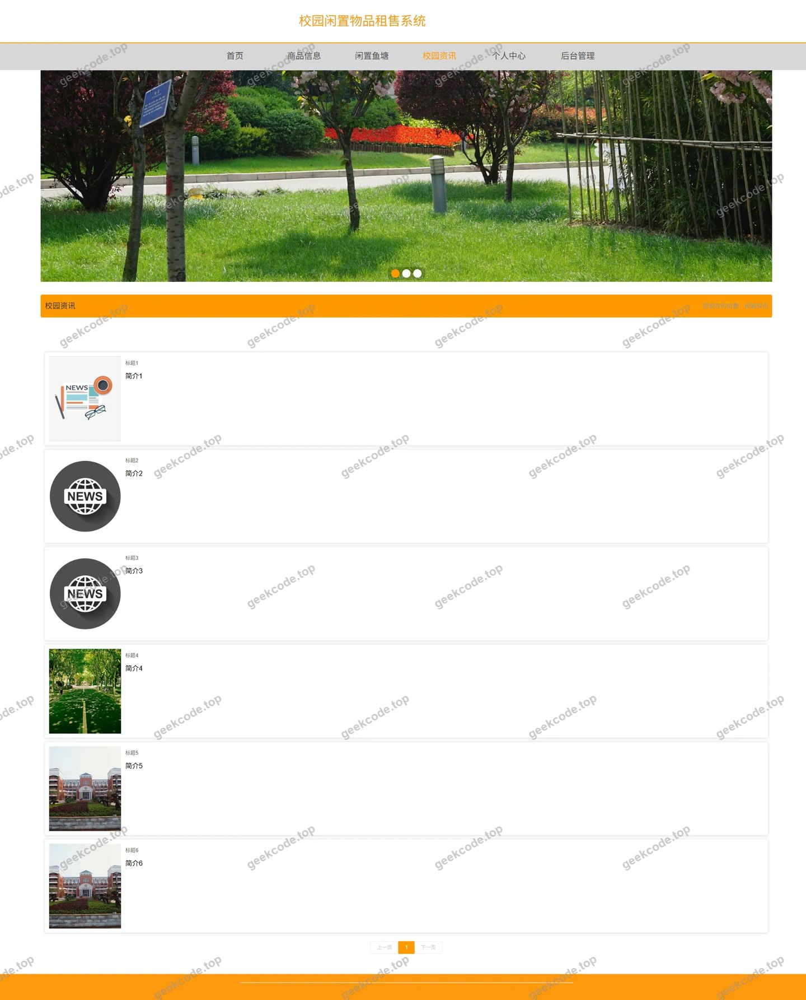</a>

<h4>前台-商品信息列表</h4>

<h4>前台个人中心</h4>

<a href="https://geekcode.top/archives/%E6%A0%A1%E5%9B%AD%E9%97%B2%E7%BD%AE%E7%89%A9%E5%93%81%E7%A7%9F%E5%94%AE%E7%B3%BB%E7%BB%9F?utm_source=github" title="查看完整源码">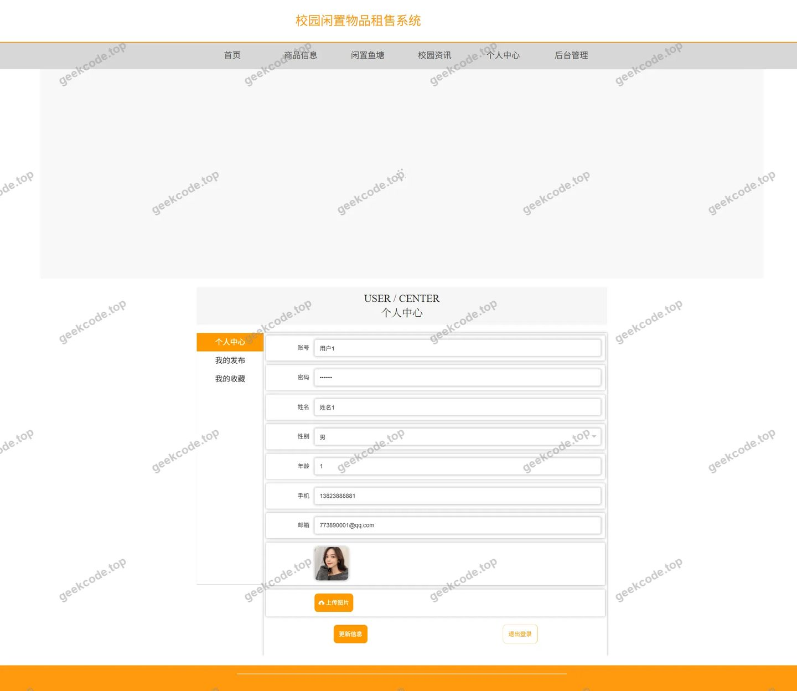</a>

<h4>前台-闲置鱼塘详情</h4>

<h4>前台-校园资讯详情</h4>

<a href="https://geekcode.top/archives/%E6%A0%A1%E5%9B%AD%E9%97%B2%E7%BD%AE%E7%89%A9%E5%93%81%E7%A7%9F%E5%94%AE%E7%B3%BB%E7%BB%9F?utm_source=github" title="查看完整源码">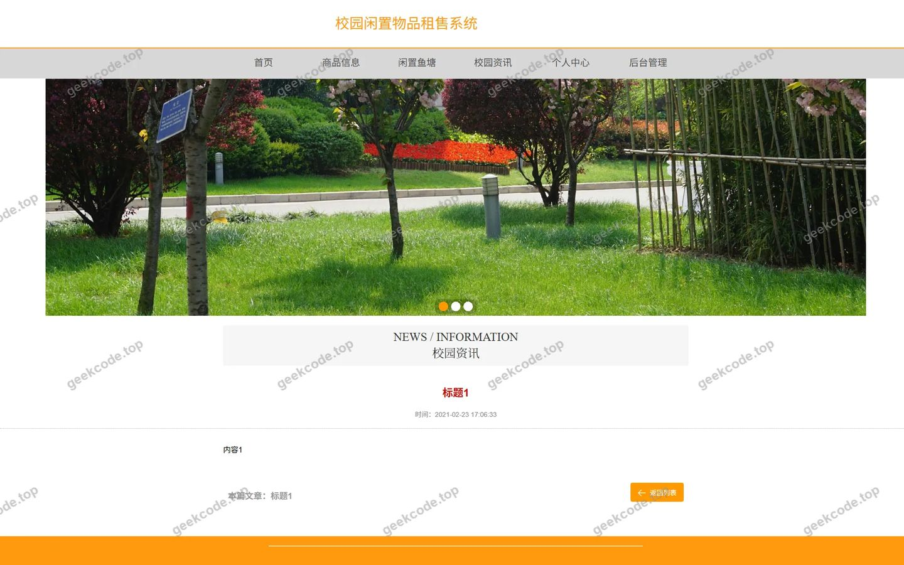</a>

<h4>前台-商品信息详情</h4>

<a href="https://geekcode.top/archives/%E6%A0%A1%E5%9B%AD%E9%97%B2%E7%BD%AE%E7%89%A9%E5%93%81%E7%A7%9F%E5%94%AE%E7%B3%BB%E7%BB%9F?utm_source=github" title="查看完整源码">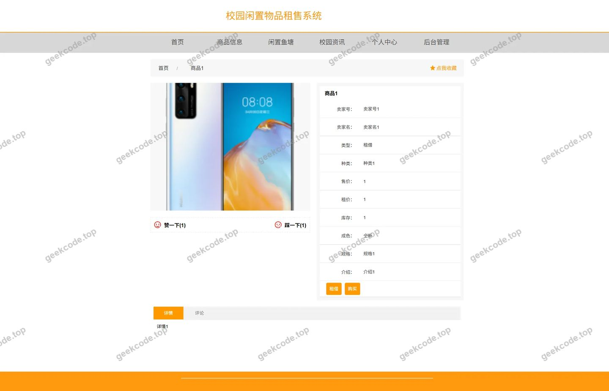</a>

<h3>后台管理端</h3>
<h4>后台-登录页</h4>

<h4>后台-卖家</h4>

<a href="https://geekcode.top/archives/%E6%A0%A1%E5%9B%AD%E9%97%B2%E7%BD%AE%E7%89%A9%E5%93%81%E7%A7%9F%E5%94%AE%E7%B3%BB%E7%BB%9F?utm_source=github" title="查看完整源码">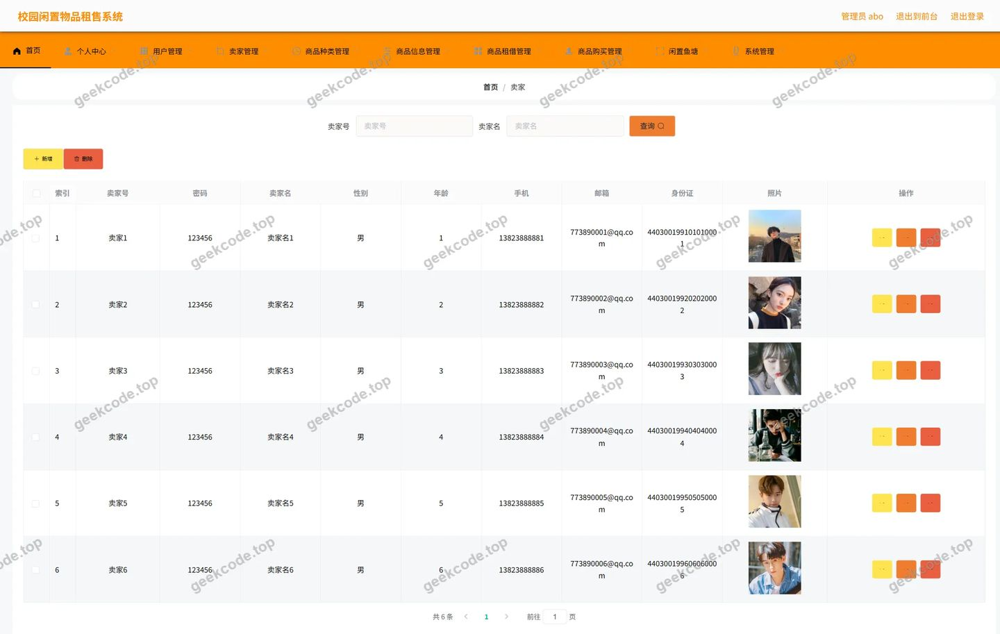</a>

<h4>后台-商品购买</h4>

<a href="https://geekcode.top/archives/%E6%A0%A1%E5%9B%AD%E9%97%B2%E7%BD%AE%E7%89%A9%E5%93%81%E7%A7%9F%E5%94%AE%E7%B3%BB%E7%BB%9F?utm_source=github" title="查看完整源码">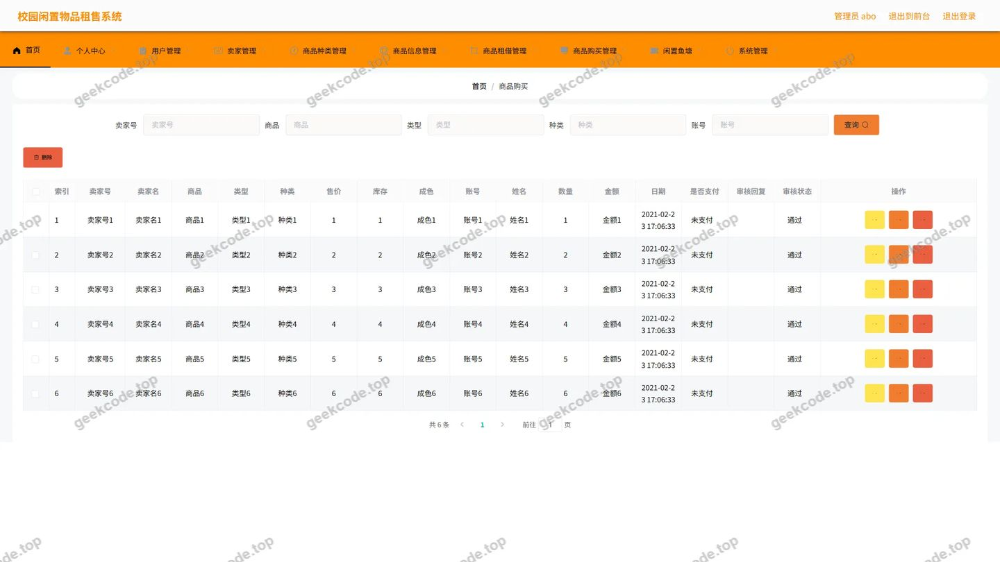</a>

<h4>后台-商品信息评论</h4>

<a href="https://geekcode.top/archives/%E6%A0%A1%E5%9B%AD%E9%97%B2%E7%BD%AE%E7%89%A9%E5%93%81%E7%A7%9F%E5%94%AE%E7%B3%BB%E7%BB%9F?utm_source=github" title="查看完整源码">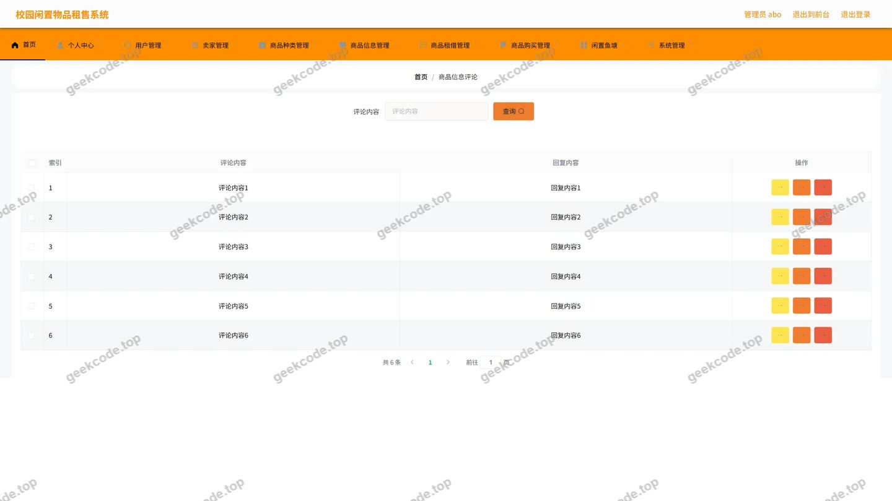</a>

<h4>后台-商品租借</h4>

<a href="https://geekcode.top/archives/%E6%A0%A1%E5%9B%AD%E9%97%B2%E7%BD%AE%E7%89%A9%E5%93%81%E7%A7%9F%E5%94%AE%E7%B3%BB%E7%BB%9F?utm_source=github" title="查看完整源码">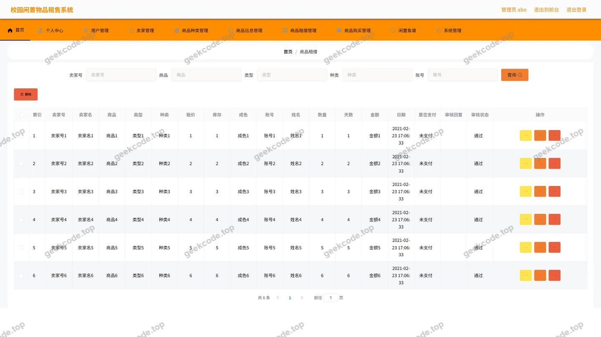</a>

<h4>后台首页</h4>

<a href="https://geekcode.top/archives/%E6%A0%A1%E5%9B%AD%E9%97%B2%E7%BD%AE%E7%89%A9%E5%93%81%E7%A7%9F%E5%94%AE%E7%B3%BB%E7%BB%9F?utm_source=github" title="查看完整源码">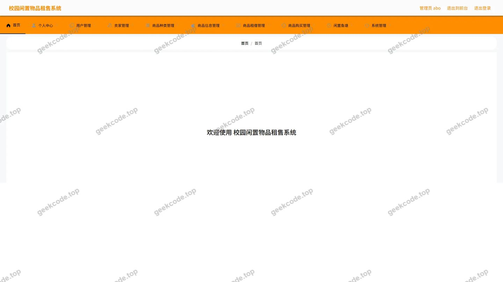</a>

<h4>后台-校园资讯</h4>

<a href="https://geekcode.top/archives/%E6%A0%A1%E5%9B%AD%E9%97%B2%E7%BD%AE%E7%89%A9%E5%93%81%E7%A7%9F%E5%94%AE%E7%B3%BB%E7%BB%9F?utm_source=github" title="查看完整源码">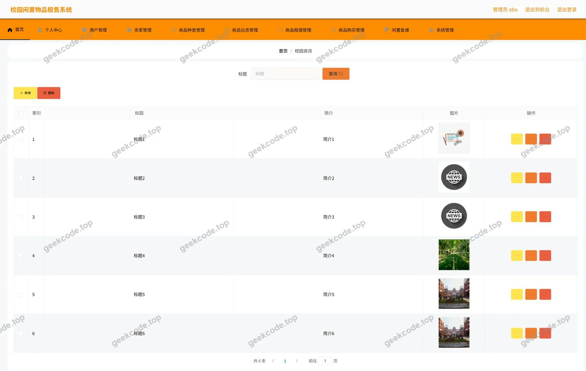</a>

<h4>后台-用户</h4>

<a href="https://geekcode.top/archives/%E6%A0%A1%E5%9B%AD%E9%97%B2%E7%BD%AE%E7%89%A9%E5%93%81%E7%A7%9F%E5%94%AE%E7%B3%BB%E7%BB%9F?utm_source=github" title="查看完整源码">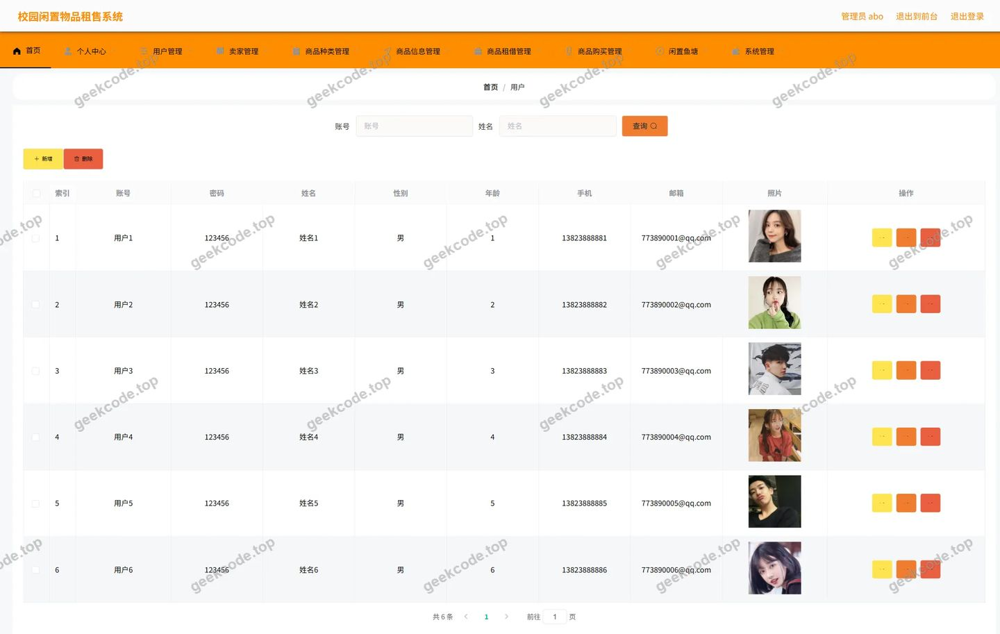</a>

---

## 获取完整源码

| 项目 | 说明 |
| --- | --- |
| 项目名 | 校园闲置物品租售系统 |
| 运行截图 | 本文 19 张（站点带水印原图，仓库 `images/` 目录） |
| 完整源码 | [https://geekcode.top/archives/%E6%A0%A1%E5%9B%AD%E9%97%B2%E7%BD%AE%E7%89%A9%E5%93%81%E7%A7%9F%E5%94%AE%E7%B3%BB%E7%BB%9F?utm_source=github](https://geekcode.top/archives/%E6%A0%A1%E5%9B%AD%E9%97%B2%E7%BD%AE%E7%89%A9%E5%93%81%E7%A7%9F%E5%94%AE%E7%B3%BB%E7%BB%9F?utm_source=github) |
| 咨询微信 | **ir9372**（备注：jingpin-yuanma） |
| 更多项目 | [极客代码 geekcode.top](https://geekcode.top/?utm_source=github) |

> 需要源码、部署、改配置、跑不起来等问题，加微信 ir9372 沟通，说明项目名即可。
